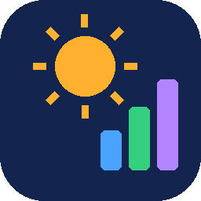
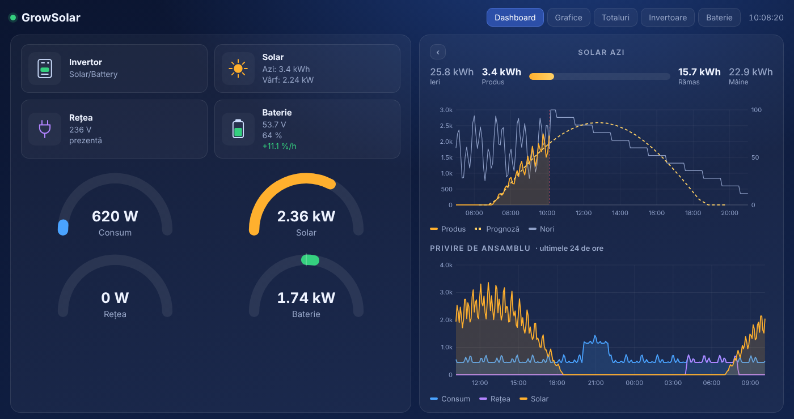
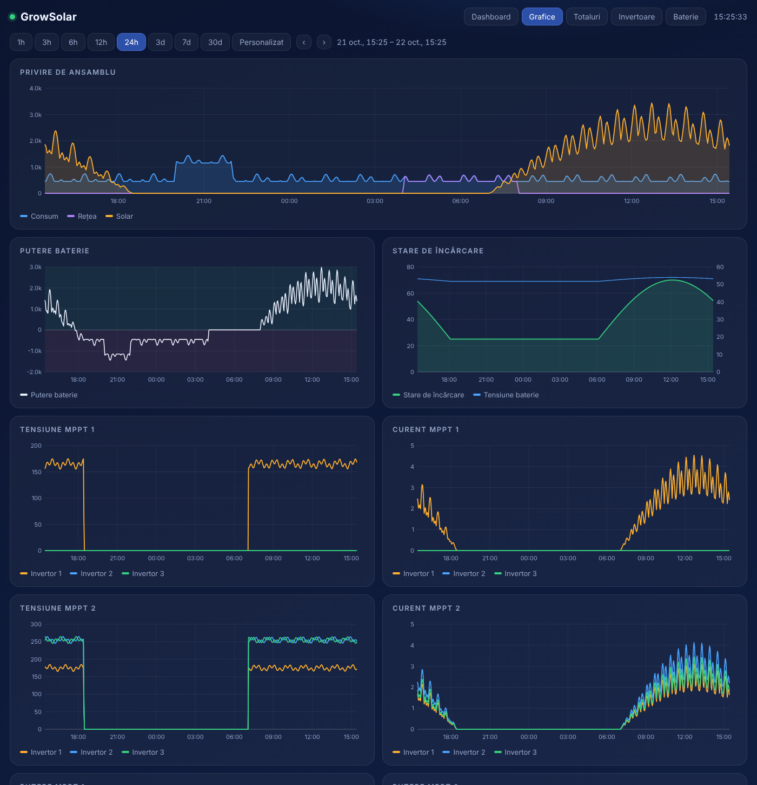
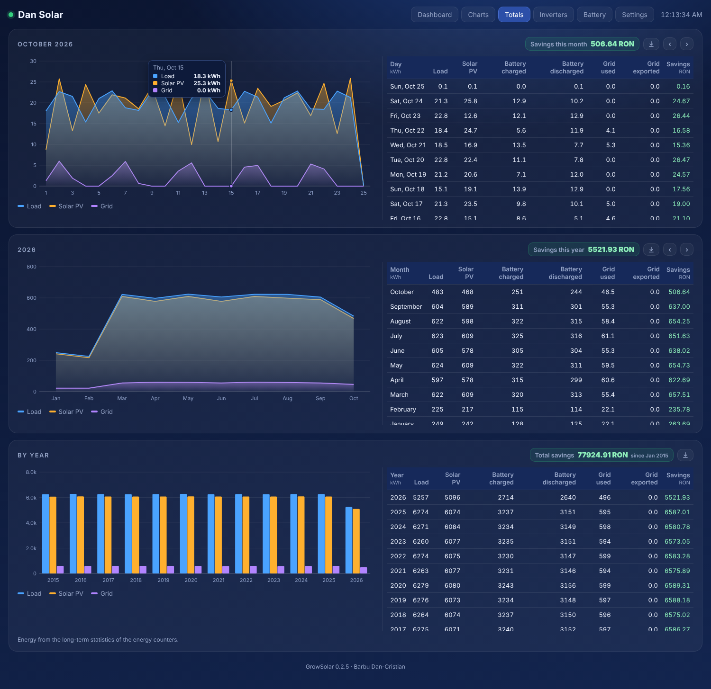
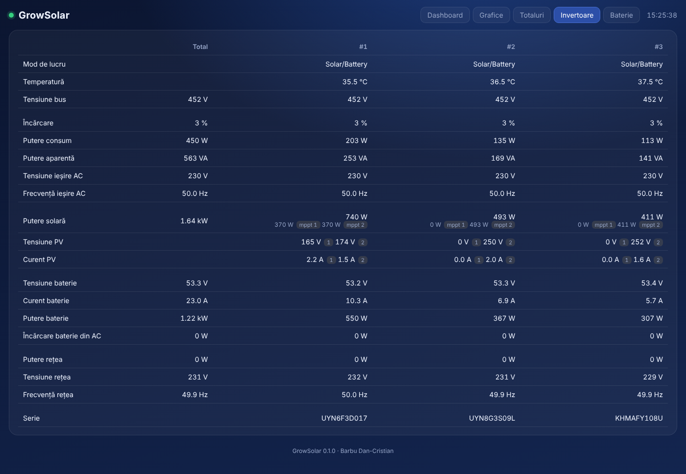
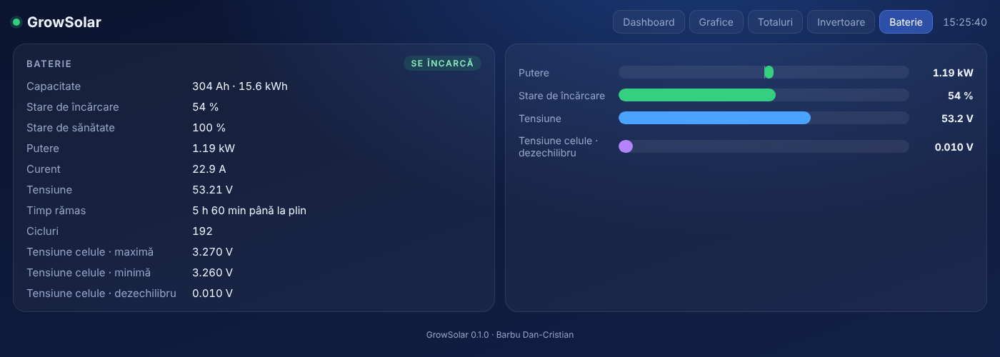
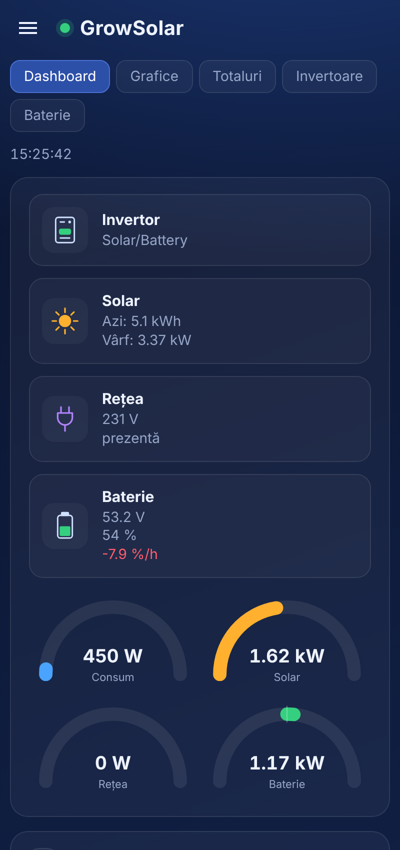

# GrowSolar

Un dashboard solar pentru Home Assistant, făcut pentru invertoarele off-grid **Growatt SPF** (unul sau mai multe, de exemplu câte unul pe fiecare fază). Adaugă în bara laterală pagina **GrowSolar** cu cinci vederi: **Dashboard**, **Grafice**, **Totaluri**, **Invertoare** și **Baterie**.

> **English:** [README.md](README.md)

Citește datele din senzorii pe care îi ai deja în Home Assistant:

- **DongleGrowatt**: stick-ul Growatt ShineWiFi-X2 cu firmware-ul [Growatt-SPF6K-HA](https://github.com/barbudancristian/Growatt-SPF6K-HA) și pachetele lui pentru Home Assistant;
- **Solar Assistant**: prin integrarea lui MQTT;
- **orice alți senzori** pe care îi alegi de mână.

Senzorii sunt găsiți automat după ID-ul lor unic, deci nu contează cum i-ai redenumit.

*Capturile arată date de exemplu.*

## Vederi

**Dashboard**: modul de lucru al invertorului, energia solară de azi și vârful zilei, tensiunea rețelei, tensiunea bateriei, starea de încărcare și cât de repede se schimbă (%/h). Indicatoare live pentru consum, solar, rețea și baterie. *Solar azi* cu ieri, produs, rămas și mâine, curba de putere comparată cu prognoza și cu norii. Privire de ansamblu peste consum, rețea și solar în ultimele 24 de ore. Apeși pe cardul invertorului sau al bateriei ca să deschizi pagina lui.

**Grafice**: de la 1 oră la 30 de zile sau un interval ales de tine, cu ‹ › ca să mergi înapoi și înainte în timp. Ansamblu, puterea și starea de încărcare a bateriei, cu tensiunea. Tensiunea, curentul și puterea pe MPPT 1 și 2 pentru fiecare invertor. Puterea solară, curentul bateriei și consumul, totale și pe fiecare invertor. Tensiunea și temperatura bateriei, tensiunea de ieșire AC, temperatura invertoarelor, tensiunea și frecvența rețelei, tensiunea bus. Ții degetul sau mouse-ul pe grafic ca să citești valorile; apeși pe o intrare din legendă ca să ascunzi linia.

**Totaluri**: ultimele 30 de zile și ultimele 12 luni ca bare, cu un tabel cu consumul, producția solară, energia încărcată și descărcată din baterie, energia luată din rețea și trimisă în rețea, plus economiile la prețul tău.

**Invertoare**: toate valorile, una lângă alta pentru fiecare invertor, cu o coloană de total: mod, temperatură, tensiune bus, consum, ieșire AC, PV pe fiecare MPPT, baterie, rețea, priorități și serie.

**Baterie**: capacitate, stare de încărcare și de sănătate, putere, curent, tensiune, timpul până la plin sau gol, cicluri, tensiunile celulelor și dezechilibrul, temperatura.

Pagina merge și pe telefon, în română sau engleză, după limba din profilul tău Home Assistant.

## Instalare cu HACS

1. HACS → **⋮ → Custom repositories** → adaugi `https://github.com/barbudancristian/GrowSolar`, tipul **Integration**.
2. Cauți **GrowSolar** în HACS → **Download**.
3. Repornești Home Assistant.
4. **Settings → Devices & services → Add integration → GrowSolar**.

Instalare manuală: copiezi folderul `custom_components/growsolar` în `config/custom_components/` și repornești.

## Configurare

1. **Sursa datelor**: DongleGrowatt, Solar Assistant sau manual. Fereastra arată câte invertoare a găsit pentru fiecare sursă.
2. **Sistem**: numele din bara laterală, numărul de invertoare, capacitatea bateriei (kWh), puterea panourilor (kWp, pentru indicatorul solar), prețul energiei și moneda.
3. Doar pentru sursa manuală: alegi senzorii (putere solară, consum, baterie, rețea, stare de încărcare, contoare de energie).

Poți schimba totul mai târziu din **Configure**, unde poți și adăuga sau înlocui senzori individuali. Pagina se reîncarcă singură.

## Cerințe și note

- Home Assistant 2024.11 sau mai nou, cu **recorder** pornit (e pornit implicit).
- *Graficele* folosesc istoricul (până la 3 zile) și statisticile la 5 minute sau pe oră (pentru intervale mai lungi). *Totalurile* folosesc statisticile pe termen lung ale contoarelor de energie (`state_class: total_increasing`), deci se completează din ziua în care au pornit contoarele.
- Prognoza: curba punctată pe toată ziua, *Rămas* și *Mâine* vin din prognoza solară din setările Energy ale Home Assistant (**Solcast** sau **Forecast.Solar**); fără ea, din prognoza Solar Assistant. Norii după ora curentă și iconițele de vreme vin dintr-o entitate de vreme (prima găsită sau cea aleasă în Configure).
- Convenția de semn din pagină: puterea bateriei e pozitivă la încărcare, puterea rețelei e pozitivă când iei din rețea.
- Cu DongleGrowatt puterea din rețea e o estimare (rețea spre consum în bypass plus încărcare din rețea), iar *Încărcat în baterie* lipsește, pentru că invertorul nu are contor pentru asta.
- Totul rămâne în Home Assistant-ul tău: pagina nu folosește servicii de pe internet și nici biblioteci externe.

## Credite și licență

Autor: **Barbu Dan-Cristian**. Stilul vizual urmează dashboard-ul solar pentru Home Assistant al lui **Andrei Cristetiu**.

Licență MIT, vezi [LICENSE](LICENSE). Proiectul nu e afiliat cu Growatt sau Solar Assistant; numele aparțin proprietarilor lor.
